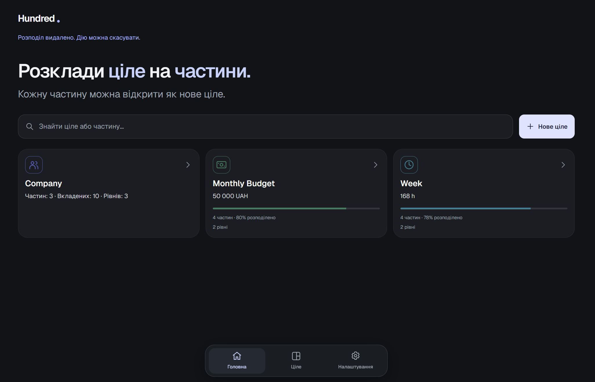
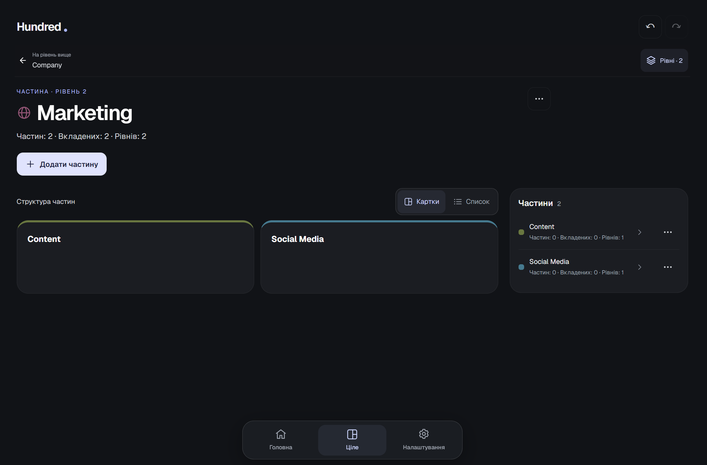
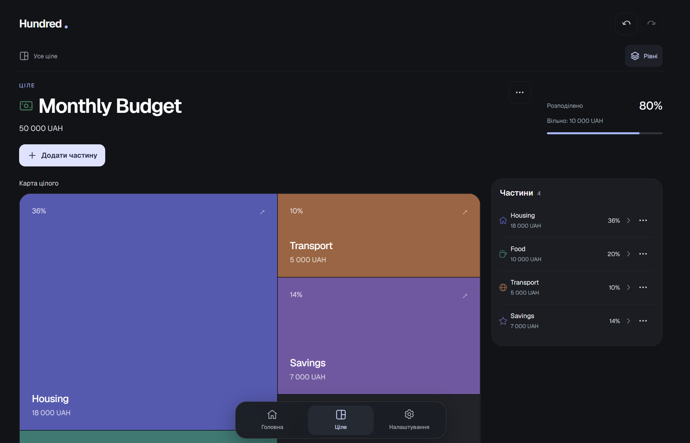
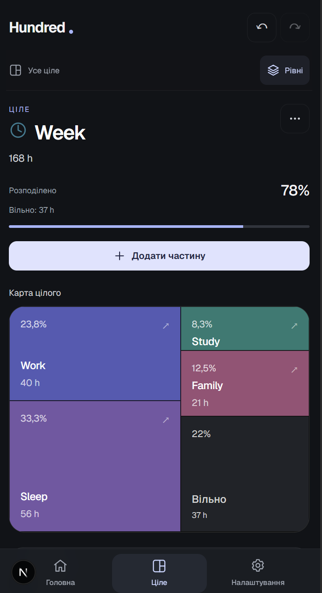

# Hundred

**Break a whole into parts.**

Hundred is a system for describing a Whole through Parts, where every Part can become a new Whole. Use it to explore a team, project, budget, time, or anything else with parts.

[Open Hundred](https://hundred-pearl-ten.vercel.app) · [Screenshot capture guide](docs/screenshots/README.md) · [PWA documentation](docs/pwa.md)

[Changelog](CHANGELOG.md) · [Roadmap](ROADMAP.md) · [Release checklist](docs/release-checklist.md)

> **Українською:** Hundred допомагає описати ціле через частини. Кожну частину можна відкрити як нове ціле.



## How it works

**Whole → Parts → New Whole**

Create a Whole, add Parts, and open any Part to explore or add its own Parts. For example, a team can contain departments; each department can become a Whole containing its members. Navigate back to a parent or use **Levels** to move through the hierarchy.

## Two kinds of Whole

### Structural Whole

A Structural Whole needs only a name. Use one for a hierarchy, list, organization, or project structure. Its Parts can be structural or measured, and quantity is optional. Switch between cards and a list without changing the data.

### Measured Whole

A Measured Whole has a positive quantity and a unit, such as a budget of 50,000 UAH or a week of 168 hours. Its Parts use the same unit and can be entered as amounts or percentages. Their total cannot exceed the Whole. A proportional treemap shows the Parts and remaining capacity; open a Part to divide it further.

A Structural Whole can contain another Structural Whole or a Measured Whole. For example: **Organization → Department → Department budget → Rent**. A Measured Whole contains measured Parts with the same unit.

## Key features

- Nested Wholes and Parts, with navigation to ancestors and neighboring Parts.
- Structural cards or lists and a proportional treemap for measured Parts.
- Local search across saved Wholes and nested Parts, with paths to results.
- Sibling reordering, editing, duplication of a Whole, and undo/redo.
- Optional colors and icons; keyboard-accessible forms and navigation.
- Local-first autosave, JSON backup/import, and offline PWA support.
- Ukrainian and English interface; light, dark, and system themes.

## Screenshots

### Structural Whole

Marketing is opened as a Whole within Company, with Content and Social Media as its Parts.



### Measured Whole

Monthly Budget shows measured Parts, a proportional treemap, and the remaining amount.



### Mobile

The Week Whole and its proportional Parts adapt to a narrow screen.



## Why Hundred?

Lists and quantities often sit at different levels of the same idea. Hundred lets a named structure and a measured amount live in the same hierarchy, without forcing a quantity onto every Part. Each Part can become the starting point for a closer look.

## Local-first and offline

No account or backend is required. Wholes, navigation, and preferences are stored in the current browser on the current origin; there is no automatic cloud synchronization. Export a JSON backup before clearing browser data or moving to another device. Import adds independent copies rather than replacing existing Wholes.

When at least one Whole exists, Home may show a non-blocking backup reminder. **Remind me later** postpones it for seven days; starting a backup download suppresses it for 30 days. Reminder timestamps are stored separately from the Wholes in the same browser and shared with other open tabs. A started download does not guarantee that the file was saved successfully.

The production PWA can work offline after its service worker and app assets have completed an initial online installation. An installable app shortcut is optional and browser support varies. A first page load alone does not guarantee the offline installation has finished; private browsing, storage eviction, clearing site data, or a different origin can affect availability. The cache is not a backup of your data.

Updates download in the background and wait until all Hundred tabs and windows close. Development mode does not register a service worker. See the [PWA guide](docs/pwa.md) for installation requirements, cache policy, limitations, and manual offline/update checks.

## Data format and migration

The current storage and export format is **v3**, with an explicit structural or measured type on each node. The app accepts **v1 → v3**, **v2 → v3**, and **v3 → v3**: legacy nodes become measured, while values, units, IDs, hierarchy, active Whole, and valid navigation paths are retained. Invalid paths are shortened to the last existing ancestor.

The localStorage key `hundred.document.v1` is retained for compatibility; existing data is read without manual migration and the next save writes v3. Invalid saved data is not overwritten automatically. Imported Wholes receive new IDs. Undo/redo history is in memory and does not persist across reloads.

A percentage entered for a measured Part is converted to an absolute amount. Changing its parent's quantity does not automatically recalculate its Parts. Editing preserves a node's type and unit; changing either after creation is not currently supported. Colors and icons are optional v3 attributes and are included in backups and undo/redo.

## Technical limits

- Up to **20 Wholes**, and **5,000 nodes** and **41 levels** per tree.
- Measured values must be greater than zero and at most **1,000,000,000**, with up to **6 decimal places**; a comma or dot is accepted as the decimal separator.
- Names are limited to **120 characters**, units to **20 characters**, and imported backup files to **4 MB**. Browser storage capacity varies.
- Search shows up to **100 results** and prompts for a more specific query when there are more.

## Development

The app uses **Next.js 16.4.6**, **React 19**, **TypeScript**, and **Tailwind CSS 4**. Use Node.js 24.

```sh
npm ci
npm run dev
```

Open [http://localhost:3000](http://localhost:3000). Data created there belongs to that browser and origin; it is separate from the deployed app.

## Architecture overview

- `src/types/node.ts` defines the discriminated Structural/Measured Node union.
- `src/lib/node-mode.ts`, `tree.ts`, and `document.ts` implement node modes, traversal, validation, tree edits, and the document codec.
- `src/lib/collection.ts`, `history.ts`, and `use-document.ts` handle collections, migration, backups, history, and local persistence.
- `src/components/` contains forms, navigation, structural views, the measured treemap, and local search.
- `src/lib/i18n.ts` provides Ukrainian and English UI text; `app/page.tsx` connects the workspace.
- `src/pwa/worker.js` and `scripts/build-pwa.mjs` define and generate the service worker and offline shell.

## Testing

```sh
npm test
npm run lint
npm run build
```

Core tests cover structural and measured trees, precision and capacity, navigation, search, editing, history, import/export, and migrations. PWA tests cover worker behavior and build output; browser installation, storage eviction, and update lifecycle still require [manual PWA QA](docs/pwa.md#manual-qa-production-build).

The Vercel build command runs tests, lint, and the production build through `vercel.json`.

### Browser E2E tests

Install Playwright's Chromium headless browser once, build the current app, then run the suite:

```sh
npx playwright install --only-shell chromium
npm run build
npm run test:e2e
```

Playwright starts the production server on `127.0.0.1:3217`; this port must be free. Rebuild after changing app code so the suite tests the current version. Each test uses its own browser context, isolated from your browser and other tests. The Chromium suite covers onboarding, structural and measured Wholes, validation, editing, deletion, undo/redo, persistence, language, theme, a mobile viewport, and accessibility-oriented keyboard, form, and dialog checks.

The suite blocks service workers. It checks the backup reminder after an already loaded page goes offline, but does not test offline app loading, browser installation, or the update lifecycle. Those require the mocked PWA tests and [manual PWA QA](docs/pwa.md#manual-qa-production-build). The browser suite is not part of the Vercel deployment command; a separate CI job can install Chromium, build, and run it when desired.

## License

Copyright © 2026 Vitalii. All rights reserved. Hundred's source code is available for portfolio viewing and review; other use requires permission, subject to applicable law and GitHub's Terms of Service. Third-party dependencies have their own licenses. See [LICENSE](LICENSE) for details.
